



<a href="https://allenwu-blip.github.io/sparkle-demo/">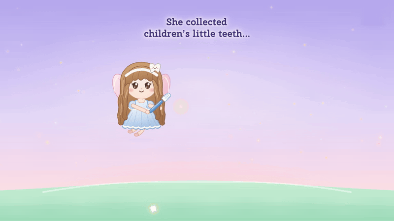</a>

<a href="https://allenwu-blip.github.io/sparkle-demo/"></a>

<a href="https://github.com/allenwu-blip/mcpaudit"></a>
<a href="https://github.com/allenwu-blip/agentguard"></a>
 
<a href="https://github.com/allenwu-blip/aclaim"></a>
<a href="https://github.com/allenwu-blip/spendguard"></a>
 
<a href="https://github.com/allenwu-blip/tokenstack"></a>
<a href="https://github.com/allenwu-blip/slopguard"></a>
 
<a href="https://github.com/allenwu-blip/agenttoolbench-code"></a>
<a href="https://github.com/allenwu-blip/llm-inference-lab"></a>
 
<a href="https://github.com/allenwu-blip/agentic-serving-lab"></a>
<a href="https://github.com/allenwu-blip"></a>
 
<a href="https://github.com/allenwu-blip/embodied-data"></a>
<a href="https://github.com/allenwu-blip/agibridge"></a>
 
<a href="https://github.com/allenwu-blip/matchday-passport"></a>
<a href="https://github.com/allenwu-blip/huidu"></a>


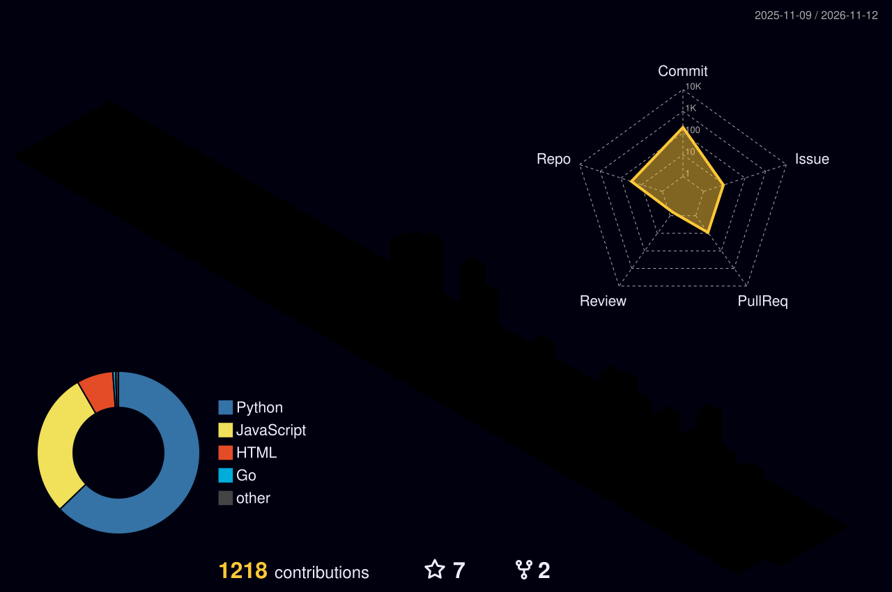

Every image here is an animated SVG drawn by <a href="tools/build.py">tools/build.py</a>; the activity graphs refresh daily via GitHub Actions.

